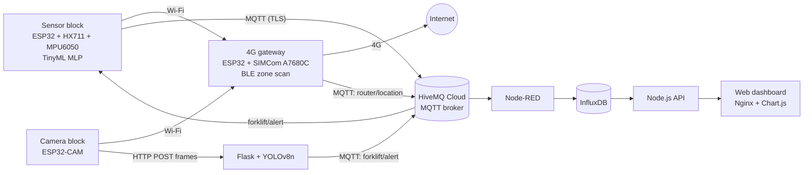

# IoT Safety Monitoring System for Forklift Operation

An end-to-end IoT system mounted on a forklift that monitors **load weight**, **tilt**, **nearby pedestrians** and **zone location**, streams the data to the cloud, and raises alerts in real time. It covers hardware, embedded firmware, MQTT telemetry, a Dockerized backend, computer vision and a lightweight on-device ML model.

## Features

- **Load and tilt monitoring**: HX711 load cell and MPU6050 IMU on an ESP32. A 50 Hz complementary filter (alpha = 0.96) fuses gyroscope and accelerometer data into a single `tilt` value, with startup calibration.
- **On-device classification (TinyML)**: a small MLP running on the ESP32 classifies overload and unbalance states.
- **Pedestrian detection**: an ESP32-CAM sends frames to a Flask service running YOLOv8n. Distance is estimated from the bounding-box height (pinhole model). A person closer than 5 m triggers a `DANGER` alert over MQTT.
- **4G connectivity**: an ESP32 + SIMCom A7680C works as a 4G Wi-Fi router (PPP + NAT) for the other blocks, and also scans BLE iBeacons to report the forklift's zone.
- **Backend and dashboard**: Node-RED, InfluxDB, a Node.js API, Nginx and a Chart.js web dashboard, all in Docker Compose.

## Architecture



MQTT topics used in the code: `forklift/data` (sensor telemetry), `forklift/alert` (alerts), `router/location` (BLE zone).

## Repository structure

```
firmware/
  sensor-block/       ESP32: HX711 + MPU6050 + TinyML + MQTT (Arduino)
  camera-esp32cam/    ESP32-CAM: captures frames and POSTs them to the server (Arduino)
  gateway-esp32/      ESP32 + A7680C 4G router and BLE scanner (ESP-IDF)
platform/
  docker-compose.yaml Node-RED, InfluxDB, Node.js API, Flask/YOLO, Nginx, ngrok
  python-server/      Flask image-processing service (YOLOv8n)
  api/                Node.js API reading from InfluxDB
  web/                Dashboard (HTML, CSS, Chart.js)
  nodered/flows.json  Node-RED flows to import
```

## Hardware

| Block | Parts |
|---|---|
| Sensor block | ESP32, HX711 + load cell, MPU6050, buzzer |
| Camera block | ESP32-CAM |
| 4G gateway | ESP32, SIMCom A7680C (wiring and power notes in `firmware/gateway-esp32/README.md`) |

## Setup

### 1. Server platform (Docker)

1. Install Docker Desktop.
2. In `platform/`, copy `.env.example` to `.env` and fill in your MQTT, InfluxDB, ngrok and API key values.
3. Run `docker compose up -d`.
4. Open `http://localhost:1880` (Node-RED), choose **Import**, select `nodered/flows.json`, and click **Deploy**. Set your MQTT broker credentials in the MQTT broker config node.
5. Open `http://localhost` for the web dashboard.

### 2. Gateway firmware (ESP-IDF)

1. Install ESP-IDF and open `firmware/gateway-esp32` with it.
2. Set the Wi-Fi AP name and password in `main/wifi_ap.h` / `main/main.c`, and the HiveMQ settings in `main/ble_scanner.c`.
3. Build and flash.

### 3. Sensor block and camera firmware (Arduino IDE)

1. Install Arduino IDE with ESP32 board support.
2. In each of `firmware/sensor-block` and `firmware/camera-esp32cam`, copy `config.example.h` to `config.h` and fill in your values (Wi-Fi must match the gateway's AP; the API key must match `API_KEY` in `platform/.env`).
3. Upload to the ESP32 and ESP32-CAM.

## Configuration and secrets

Credentials are **not** stored in this repository. `.env` and `config.h` are git-ignored; use the provided `.env.example` and `config.example.h` files as templates.

## Known limitations

- The TinyML model was trained on unfiltered (pre-complementary-filter) roll/pitch data, so it should be retrained on filtered data before relying on it.
- Pedestrian distance uses a bounding-box-height pinhole estimate with a fixed focal length and person height (see `platform/python-server/server.py`); it is an approximation and needs calibration for a different camera.
